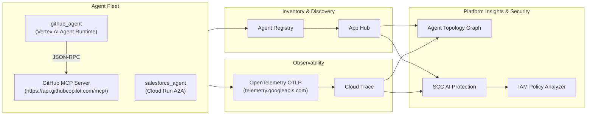

# Step-by-Step Lab Manual: Agent Topology, Discovery & SCC AI Protection

This guide walks through discovering multi-runtime AI agents (Vertex AI Agent Runtime and Cloud Run) and MCP servers in **Agent Registry** & **App Hub**, exporting OpenTelemetry traces to **Cloud Trace** to power the **Agent Topology** graph, and identifying/remediating excessive IAM permissions using **Security Command Center (SCC) AI Protection** and **Policy Analyzer**.

---

## Architecture Overview



---

## Task 1: Prepare Your Environment

### 1.1 Set Environment Variables
In Cloud Shell, configure your project, location (`us-central1`), project number, and organization ID:

```bash
export PROJECT_ID=$(gcloud config get-value project)
export LOCATION=us-central1
gcloud config set project ${PROJECT_ID}
export PROJECT_NUMBER=$(gcloud projects describe ${PROJECT_ID} --format='value(projectNumber)')
export ORGANIZATION_ID=$(gcloud projects get-ancestors ${PROJECT_ID} --format=json | jq -r '.[] | select(.type=="organization") | .id')
echo "Project: ${PROJECT_ID} (${PROJECT_NUMBER}), Org: ${ORGANIZATION_ID}, Location: ${LOCATION}"
```

### 1.2 Copy Pre-Staged Lab Scripts & Agent Code
Copy the prerequisite scripts and agent code from the project GCS bucket and run the prerequisite setup:

```bash
gcloud storage cp -r gs://${PROJECT_ID}-bucket/apex_labs .
bash apex_labs/lab2_prereqs.sh

gcloud storage cp -r gs://${PROJECT_ID}-bucket/agents .
mkdir -p ~/.vscode
gcloud storage cp -r gs://${PROJECT_ID}-bucket/settings.json ~/.vscode/
```

### 1.3 Install and Verify `agents-cli`
```bash
export PATH="${HOME}/.local/bin:${PATH}"
uvx google-agents-cli setup
uv tool upgrade google-agents-cli
agents-cli info
```

### 1.4 Confirm the Agent Fleet is Running
Verify `salesforce-agent` is deployed on Cloud Run:
```bash
gcloud run services list --project=${PROJECT_ID} --region=${LOCATION} --format="table(metadata.name)"
```

Verify `github_agent` (or `github-agent`) is deployed on Vertex AI Agent Runtime (Reasoning Engines):
```bash
curl -s -H "Authorization: Bearer $(gcloud auth print-access-token)" \
  "https://${LOCATION}-aiplatform.googleapis.com/v1/projects/${PROJECT_ID}/locations/${LOCATION}/reasoningEngines" \
  | jq -r '(.reasoningEngines // [])[] | "\(.displayName)\t\(.name)"'
```

### 1.5 Enable Observability and Discovery APIs
Enable the APIs required by Cloud Trace, App Hub, Agent Topology, Agent Registry, and SCC AI Protection:

```bash
gcloud services enable \
  observability.googleapis.com \
  cloudtrace.googleapis.com \
  telemetry.googleapis.com \
  apphub.googleapis.com \
  apptopology.googleapis.com \
  agentregistry.googleapis.com \
  cloudasset.googleapis.com \
  monitoring.googleapis.com \
  logging.googleapis.com \
  --project=${PROJECT_ID}
```

---

## Task 2: Export Traces to Cloud Trace

### 2.1 Verify OpenTelemetry Instrumentation in Code
1. Check `~/agents/salesforce-agent/pyproject.toml` to confirm `google-adk` includes the `otel-gcp` extra (`google-adk[gcp,otel-gcp]`), which installs `opentelemetry-instrumentation-google-genai`.
2. Check `~/agents/salesforce-agent/app/app_utils/telemetry.py` to confirm `setup_telemetry()` configures `get_gcp_exporters(enable_cloud_tracing=True)` targeting `telemetry.googleapis.com`.

### 2.2 Grant Telemetry Traces Writer Role to Cloud Run Service Account
Agent Runtime exports traces automatically via managed telemetry, whereas Cloud Run exports traces using its runtime service account (the Compute Engine default service account):

```bash
export SF_SA=$(gcloud run services describe salesforce-agent --region=${LOCATION} \
  --format='value(spec.template.spec.serviceAccountName)')

gcloud projects add-iam-policy-binding ${PROJECT_ID} \
  --member="serviceAccount:${SF_SA}" \
  --role="roles/telemetry.tracesWriter" \
  --condition=None
```

### 2.3 Generate Traffic Across the Agent Fleet
Look up the Reasoning Engine URL for `github_agent` and send a query using `agents-cli run`:

```bash
export RE_NAME=$(curl -s -H "Authorization: Bearer $(gcloud auth print-access-token)" \
  "https://${LOCATION}-aiplatform.googleapis.com/v1/projects/${PROJECT_ID}/locations/${LOCATION}/reasoningEngines" \
  | jq -r '(.reasoningEngines // [])[0].name')

export GH_URL="https://${LOCATION}-aiplatform.googleapis.com/v1/${RE_NAME}"

agents-cli run \
  --url "${GH_URL}" \
  --mode adk \
  --app-name app \
  "Search for open issues or repositories"
```

You can also query `salesforce-agent` directly to generate additional trace spans:
```bash
export SF_URL=$(gcloud run services describe salesforce-agent --region=${LOCATION} --format='value(status.url)')
agents-cli run \
  --url "${SF_URL}" \
  --mode adk \
  --app-name app \
  "Find Salesforce documents about onboarding"
```

### 2.4 Confirm Traces in Cloud Trace Explorer
1. In the Google Cloud Console, navigate to **Monitoring > Trace explorer**.
2. Set the time range to **Last 1 hour** and filter by span name `call_llm` or `agent_run`.
3. Click a trace to inspect its waterfall view (`invocation` / `agent_run` → `call_llm` → `execute_tool`).

---

## Task 3: Confirm Agent Runtime Agents Are Already Discovered

1. List agents automatically discovered in Agent Registry:
   ```bash
   gcloud alpha agent-registry agents list \
     --location=${LOCATION} \
     --project=${PROJECT_ID} \
     --format="table(displayName)"
   ```
2. Confirm App Hub classifies the Agent Runtime workload with functional type `AGENT`:
   ```bash
   export TOKEN=$(gcloud auth print-access-token)
   curl -s -H "Authorization: Bearer ${TOKEN}" \
     -H "x-goog-user-project: ${PROJECT_ID}" \
     "https://apphub.googleapis.com/v1/projects/${PROJECT_ID}/locations/${LOCATION}/discoveredWorkloads" \
     | jq -r '.discoveredWorkloads[] | "\(.workloadProperties.functionalType.type // "-")\t\(.workloadReference.uri)"'
   ```

---

## Task 4: Register the Cloud Run Agent (`salesforce-agent`)

Cloud Run services are not automatically labeled as agents—you register them in Agent Registry using their A2A Agent Card.

### 4.1 Grant Discovery Engine Service Agent Invoker Permission
Create the Discovery Engine service identity and grant it `roles/run.invoker` on `salesforce-agent`:

```bash
gcloud beta services identity create \
  --service=discoveryengine.googleapis.com \
  --project=${PROJECT_ID}

gcloud run services add-iam-policy-binding salesforce-agent \
  --region=${LOCATION} \
  --project=${PROJECT_ID} \
  --member="serviceAccount:service-${PROJECT_NUMBER}@gcp-sa-discoveryengine.iam.gserviceaccount.com" \
  --role="roles/run.invoker"
```

### 4.2 Download the A2A Agent Card and Register `salesforce-agent`
```bash
export SF_URL=$(gcloud run services describe salesforce-agent --region=${LOCATION} --format='value(status.url)')
export TOKEN=$(gcloud auth print-identity-token)

curl -s -H "Authorization: Bearer ${TOKEN}" \
  "${SF_URL}/a2a/app/.well-known/agent-card.json" -o salesforce_card.json

gcloud alpha agent-registry services create salesforce-agent \
  --location=${LOCATION} \
  --project=${PROJECT_ID} \
  --agent-spec-type=a2a-agent-card \
  --agent-spec-content=salesforce_card.json
```

Verify both `github_agent` and `salesforce_agent` appear in Agent Registry:
```bash
gcloud alpha agent-registry agents list \
  --location=${LOCATION} \
  --project=${PROJECT_ID} \
  --format="table(displayName)"
```

---

## Task 5: Register the GitHub MCP Server

Register the GitHub Copilot MCP server (`https://api.githubcopilot.com/mcp/`) in Agent Registry using `--mcp-server-spec-type=no-spec` and JSON-RPC binding:

```bash
gcloud alpha agent-registry services create github-mcp \
  --location=${LOCATION} \
  --project=${PROJECT_ID} \
  --mcp-server-spec-type=no-spec \
  --interfaces="url=https://api.githubcopilot.com/mcp/,protocolBinding=jsonrpc"
```

Confirm the MCP server is registered:
```bash
gcloud alpha agent-registry mcp-servers list \
  --location=${LOCATION} \
  --project=${PROJECT_ID}
```

---

## Task 6: View the Agent Topology Graph

1. In the Google Cloud Console, go to **Agent Platform > Agent Registry**.
2. Select your lab project at the top.
3. On the **Agents** tab, click an agent (e.g., `github_agent`).
4. Select the **Topology** tab.
5. Confirm that `github_agent` (Agent Runtime), `salesforce_agent` (Cloud Run), and the GitHub MCP server appear in a unified topology graph.
   > **Note**: Because Agent Topology aggregates traces in batches, the graph can take time to populate. You can verify the live telemetry pipeline anytime in **Trace Explorer** by filtering for `call_llm`.

---

## Task 7: Review the Fleet in SCC AI Protection & Introduce a Risk

1. In the Google Cloud Console, go to **Agent Platform > Agents > Security** (`https://console.cloud.google.com/agent-platform/security`) to view the AI asset inventory and risk dashboard.
2. Simulate an over-privileged agent service account by ensuring `roles/editor` is granted to the `salesforce-agent` service account:
   ```bash
   export SF_SA=$(gcloud run services describe salesforce-agent --region=${LOCATION} \
     --format='value(spec.template.spec.serviceAccountName)')

   gcloud projects add-iam-policy-binding ${PROJECT_ID} \
     --member="serviceAccount:${SF_SA}" \
     --role="roles/editor" \
     --condition=None
   ```

---

## Task 8: Identify the Security Finding and Scope with Policy Analyzer

1. In the **Agent Platform > Security** tab, review **Agents with excessive permissions** and **AI risks by severity** to locate `salesforce_agent`.
2. In the Console, go to **IAM & Admin > Policy Analyzer**:
   - Click **Create custom query**.
   - Set **Scope** to your project (`${PROJECT_ID}`).
   - Set **Parameter 1** to **Principal** and enter `serviceAccount:${SF_SA}` (obtainable via `echo ${SF_SA}`).
   - Under **Advanced options**, check **List resources within resource(s) matching your query**, then click **Analyze > Run query**.
3. Alternatively, run the equivalent Policy Analyzer query from Cloud Shell:
   ```bash
   gcloud asset analyze-iam-policy \
     --project=${PROJECT_ID} \
     --identity="serviceAccount:${SF_SA}" \
     --expand-resources
   ```
   The output proves that `roles/editor` grants access across nearly every resource in the project.

---

## Task 9: Remediate Over-Privilege and Verify Least Privilege

### 9.1 Inspect Current Roles on the Service Account
```bash
gcloud projects get-iam-policy ${PROJECT_ID} --flatten="bindings[].members" \
  --filter="bindings.members:${SF_SA}" \
  --format="value(bindings.role)"
```
Confirm the narrow required roles are present:
- `roles/aiplatform.user`
- `roles/cloudtrace.agent`
- `roles/logging.logWriter`
- `roles/telemetry.tracesWriter`

### 9.2 Remove the Broad `roles/editor` Binding
```bash
gcloud projects remove-iam-policy-binding ${PROJECT_ID} \
  --member="serviceAccount:${SF_SA}" \
  --role="roles/editor"
```

### 9.3 Verify `roles/editor` is Removed
```bash
gcloud projects get-iam-policy ${PROJECT_ID} \
  --flatten="bindings[].members" \
  --filter="bindings.members:${SF_SA} AND bindings.role:roles/editor" \
  --format="value(bindings.role)"
```
The command returns nothing, confirming `roles/editor` has been removed and `salesforce-agent` operates with least privilege.
